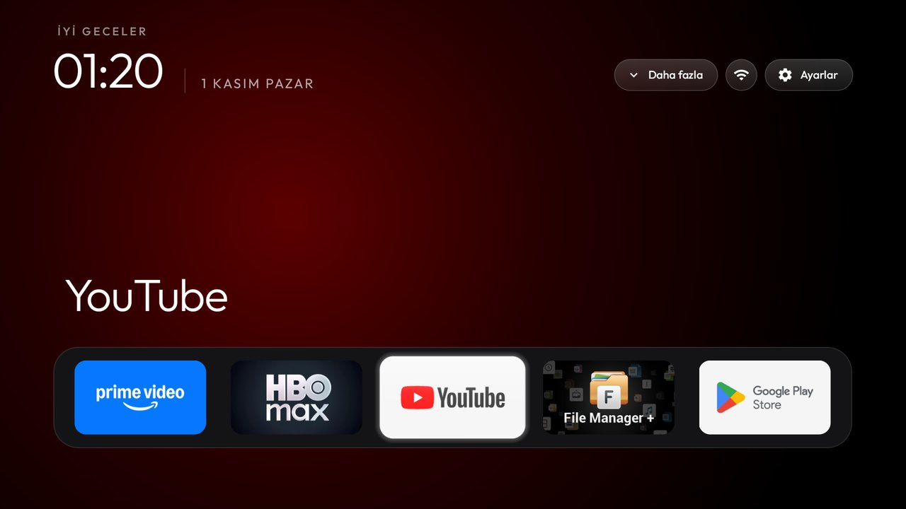
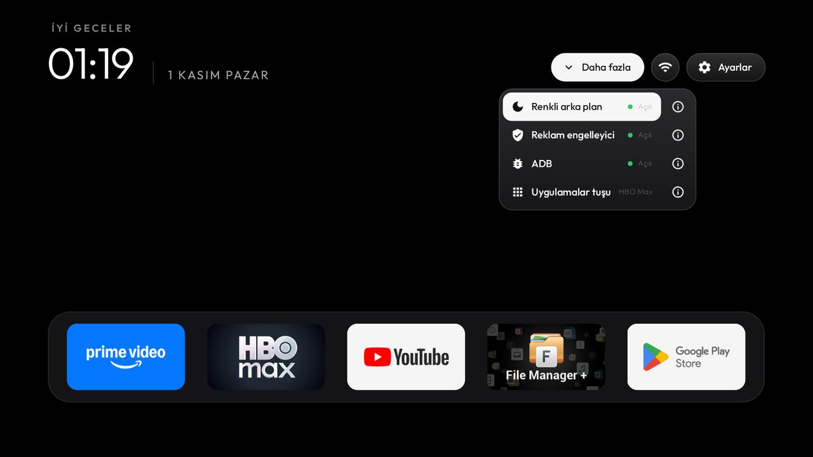
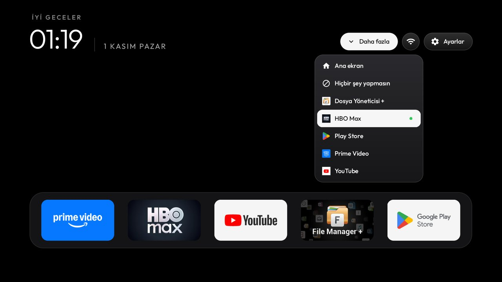
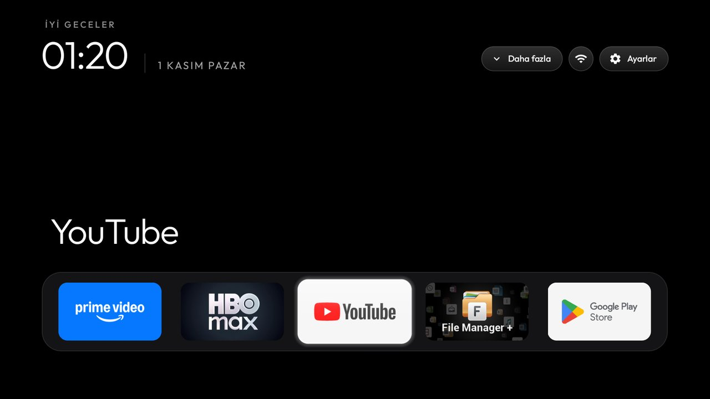

# Xiaomi Mi TV Stick (MiTV-AESP0): reklamsız, sade ana ekran

> **⚠️ Sorumluluk reddi:** Bu rehberi uygularken çubuğunu bozan, kuramayan ya da veri kaybı yaşayan kişilerden
> sorumluluk kabul etmiyoruz; her adım kendi riskinizdedir. Resmî değildir, Xiaomi veya Google ile ilgisi yoktur.
> Hiçbir uygulama silinmez, yalnızca devre dışı bırakılır ve geri alınabilir.
>
> *Disclaimer: we take no responsibility for anyone who cannot complete these steps or damages their device.
> Unofficial, not affiliated with Xiaomi or Google; use at your own risk. Nothing is uninstalled.*

Bu klasör, [CleanYourTV](https://github.com/Gathin23/cleanyourtv) projesinin bu fork'unda **Xiaomi Mi TV Stick**
(model kodu MiTV-AESP0, Android TV 9) için yapılanları anlatır: Xiaomi ve Google reklam satırları, izleme takibi ve
gereksiz servisler kapatılır, yerine sade ve hızlı bir ana ekran kurulur. Aynı yazarın Dijitsu TV için hazırladığı
fork: [cleanyourtv-dijitsu](https://github.com/mehmetfurkaneroglu/cleanyourtv-dijitsu).



## Neler var

- **Sade ana ekran:** Saat, tarih ve en fazla 5 favori uygulama. Reklamlı "önerilen film" satırları yok.
- **Renkli arka plan:** Üzerinde durduğunuz uygulamanın rengi arka plana yayılır. Gece göz almasın diye tek tuşla
  kapatılır, arka plan siyah kalır.
- **Daha fazla ⌄ menüsü** (Wi-Fi'nin solunda):
  - **Renkli arka plan:** Açık / Kapalı.
  - **Reklam engelleyici:** AdGuard DNS ile bütün uygulamalarda reklam ve takip adresleri engellenir. Bir uygulama
    takılırsa buradan kapatılır. YouTube reklamlarını engellemez.
  - **ADB:** Bilgisayardan bağlanmak için hata ayıklamayı açar ya da kapatır.
  - **Uygulamalar tuşu:** Kumandadaki **9 kareli** tuşun açacağı uygulamayı seçersiniz. "Ana ekran" ya da
    "Hiçbir şey yapmasın" da seçilebilir. Yeni yüklediğiniz uygulamalar listeye kendiliğinden gelir.
  - Her satırın sağındaki **ⓘ** düğmesi o seçeneğin ne yaptığını anlatır (sağ tuşla geçilir).
- **Wi-Fi yalnızca simge:** Ağ adı ekranda görünmez.
- **Daha küçük üst düğmeler:** Çubuğun ekranı yoğun pikselli olduğu için üst düğmeler ve menüler %80 boyutta.
- **Kapatılanlar:** Xiaomi'nin PatchWall ve reklam servisleri, Alphonso izleme takibi, Google öneri satırları,
  hazır gelen uygulamalar, Mi Cast, ekran koruyucular ve TV'de kullanılmayan altyapı
  (liste: [debloat.txt](debloat.txt)). Boş bellek yaklaşık **175 MB'tan 320 MB'a** çıktı.
- **Açık kalanlar:** Sesli asistan, Chromecast, sistem güncellemeleri, Mi video oynatıcı, Play Store.

| Daha fazla menüsü | Uygulamalar tuşu seçimi | Renkli arka plan kapalı |
|---|---|---|
|  |  |  |

---

## Adım adım kurulum

Toplam süre 30–45 dakika. Bilgisayar ile çubuk **aynı Wi-Fi ağında** olmalı ve çubuk açık kalmalı.

### 0. Gerekenler

| | |
|---|---|
| Bilgisayar | macOS, Linux ya da Windows |
| [Git](https://git-scm.com/downloads) | Depoyu indirmek için |
| [Python 3](https://www.python.org/downloads/) | Çubuğa bağlanan araçlar için (Windows'ta kurulumda "Add Python to PATH" işaretleyin) |
| [Android Studio](https://developer.android.com/studio) | Ana ekranı derlemek için. Kurduktan sonra **Settings → Languages & Frameworks → Android SDK** içinden **Android 14 (API 34)** ve **SDK Build-Tools 34**'ü yükleyin. JDK 17 Android Studio ile gelir. |

### 1. Çubukta geliştirici seçeneklerini ve USB hata ayıklamayı açın

1. Ayarlar → **Cihaz Tercihleri** → **Hakkında**.
2. En alttaki **Derleme (Build)** satırına gelip kumandada **OK'a 7 kez** basın. "Artık geliştiricisiniz" yazar.
3. Geri dönün → **Geliştirici seçenekleri** → **USB hata ayıklama**'yı **Açık** yapın.
   Bu çubukta ağ üzerinden bağlantı (port 5555) da bununla açılır.
4. IP adresini öğrenin: Ayarlar → **Ağ ve İnternet** → bağlı olduğunuz Wi-Fi ağı → **IP adresi**
   (ör. `192.168.1.50`).

### 2. Depoyu indirin ve araçları kurun

**macOS / Linux:**

```bash
git clone https://github.com/mehmetfurkaneroglu/cleanyourtv-mi-tv-stick.git
cd cleanyourtv-mi-tv-stick
python3 -m venv tools/venv
tools/venv/bin/pip install -r tools/requirements.txt
export TV_HOST=192.168.1.50          # kendi çubuğunuzun IP adresi
```

**Windows (PowerShell):**

```powershell
git clone https://github.com/mehmetfurkaneroglu/cleanyourtv-mi-tv-stick.git
cd cleanyourtv-mi-tv-stick
python -m venv tools\venv
tools\venv\Scripts\python.exe -m pip install -r tools\requirements.txt
$env:TV_HOST = "192.168.1.50"        # kendi çubuğunuzun IP adresi
```

### 3. Çubuğa bağlanın

```bash
tools/venv/bin/python -I tools/tv.py --probe
```

Çubuğun ekranında **"USB hata ayıklamaya izin verilsin mi?"** sorusu çıkar: **"Bu bilgisayardan her zaman izin ver"**
kutusunu işaretleyip **Tamam**'a basın. Komut `MiTV-AESP0` ve Android 9 yazmalı.

### 4. Yedek alın

```bash
mkdir -p backup
T="tools/venv/bin/python -I tools/tv.py"
$T 'pm list packages -f' > backup/packages.txt
$T 'pm list packages -d' > backup/disabled.txt
$T 'settings list global; settings list secure; settings list system' > backup/settings.txt
$T 'getprop' > backup/getprop.txt
```

Windows'ta aynı komutları `tools\venv\Scripts\python.exe -I tools\tv.py '...'` ile çalıştırın.

### 5. Reklamları ve gereksiz servisleri kapatın

```bash
tools/disable.sh examples/xiaomi-mi-tv-stick-tr/debloat.txt                                    # macOS / Linux
$T 'settings put secure screensaver_enabled 0'                                                  # ekran koruyucu ayarı
```

```powershell
powershell -ExecutionPolicy Bypass -File tools\disable.ps1 -TvHost $env:TV_HOST examples\xiaomi-mi-tv-stick-tr\debloat.txt
```

Neyin neden kapatıldığı [debloat.txt](debloat.txt) içinde yazıyor. Kullandığınız bir şey varsa (ör. Xiaomi
telefondan yansıtma için Mi Cast) o satırın başına `#` koyun. Sesli asistan, Chromecast ve güncellemeler zaten açık
kalır.

### 6. Yeni ana ekranı derleyip kurun

**macOS / Linux:**

```bash
export LC_ALL=en_US.UTF-8 JAVA_TOOL_OPTIONS="-Duser.language=en -Duser.country=US"   # Türkçe sistemlerde gerekli
HOME_KEY_SERVICE=1 launcher/build-and-install.sh
tools/theme.sh examples/xiaomi-mi-tv-stick-tr
$T 'pm grant com.gathin.tvhome android.permission.WRITE_SECURE_SETTINGS'           # Daha fazla menüsündeki anahtarlar için
```

**Windows:**

```powershell
$env:JAVA_TOOL_OPTIONS = "-Duser.language=en -Duser.country=US"
powershell -ExecutionPolicy Bypass -File launcher\build-and-install.ps1 -TvHost $env:TV_HOST -HomeKeyService
powershell -ExecutionPolicy Bypass -File tools\theme.ps1 -TvHost $env:TV_HOST examples\xiaomi-mi-tv-stick-tr
tools\venv\Scripts\python.exe -I tools\tv.py 'pm grant com.gathin.tvhome android.permission.WRITE_SECURE_SETTINGS'
```

- Kurulum Google'ın ana ekranını **kapatır** (silmez) ve yenisini varsayılan yapar. Sonunda `Installed` yazmalı.
- `HOME_KEY_SERVICE=1` şart: kumandanın Home ve 9 kare tuşlarını yeni ana ekrana bağlayan yardımcıyı açar. Android bu
  yardımcıyı her yeniden kurulumda kapatır, bu yüzden her kurulumda verin.
- `JAVA_TOOL_OPTIONS` satırı da şart: Türkçe dil ayarlı bilgisayarlarda derleme "İ" harfi yüzünden hata verir.
- Tema komutu favorileri yükler: Prime Video, HBO Max, YouTube, File Manager+, Play Store. Kendi favorilerinizi
  sonra çubuktan seçersiniz (bkz. 8. adım).

### 7. Yeniden başlatın ve deneyin

`$T 'reboot'` ile ya da fişten çekip takarak yeniden başlatın, sonra **gerçek kumandayla** deneyin:

- [ ] Çubuk açılınca yeni ana ekran geliyor.
- [ ] **○ (yuvarlak)** tuşu ana ekranı açıyor.
- [ ] **9 kareli** tuş Daha fazla → Uygulamalar tuşu'nda seçtiğiniz şeyi yapıyor (varsayılan: ana ekran).
- [ ] Ses tuşunu basılı tutunca ses sürekli artıp azalıyor.
- [ ] Mikrofon tuşu sesli aramayı açıyor.
- [ ] Uygulamalarınız açılıp oynatıyor. Takılan olursa Daha fazla → Reklam engelleyici'yi kapatıp yeniden deneyin.

Not: **Netflix** tuşu sistemin içinde yakalanır, başka bir işe atanamaz (root gerekir). Netflix'i kapattıysanız
tuş bir şey yapmaz.

### 8. Kişiselleştirin

- **Favoriler (dock):** Ana ekranda **Ayarlar** düğmesinde **OK'a basılı tutun → Dock'u düzenle**.
- **Alttaki uygulamaların sırası:** Ayarlar'da OK'a basılı tutun → **Uygulamaları sırala** → OK ile alın, oklarla
  taşıyın, Geri ile bırakın. Sıra yeniden başlatınca korunur.
- **Daha fazla menüsü:** Renkli arka plan, Reklam engelleyici, ADB ve Uygulamalar tuşu (yukarıdaki görseller).

### 9. ADB'yi kapatın (önemli)

ADB açıkken ağınızdaki herhangi bir cihaz çubuğa bağlanabilir. Bu çubukta yalnızca "USB hata ayıklama"yı kapatmak
**yetmez**:

1. Ayarlar → Cihaz Tercihleri → **Geliştirici seçenekleri** ekranının **en üstündeki ana anahtarı** kapatın.
2. Çubuğu yeniden başlatın.
3. Kontrol edin; `closed` yazmalı:

```bash
tools/venv/bin/python -I tools/adb-closed.py 192.168.1.50
```

İleride bir değişiklik için ADB'yi yine geliştirici seçeneklerinden (ya da Daha fazla → ADB'den) açabilirsiniz.

## Geri almak

ADB açıkken:

```bash
tools/restore.sh examples/xiaomi-mi-tv-stick-tr/debloat.txt com.google.android.tvlauncher   # kapatılanları ve Google ana ekranını geri açar
tools/theme.sh --reset                                                                       # favori ayarını kaldırır
$T 'settings put secure screensaver_enabled 1'                                               # ekran koruyucu
$T 'settings put global private_dns_mode opportunistic'                                      # AdGuard DNS kapalı
$T 'settings put secure enabled_accessibility_services ""'                                   # tuş yardımcısı kapalı
```

Tek bir uygulamayı geri açmak için: `$T 'pm enable PAKET'`. Windows'ta `tools\restore.ps1` ve `tools\theme.ps1`
aynı işi yapar.

## Sorun giderme

| Sorun | Çözüm |
|---|---|
| `tv.py --probe` bağlanmıyor | IP doğru mu, aynı ağda mısınız, USB hata ayıklama açık mı? Çubuktaki izin sorusunu onayladınız mı? |
| Home tuşu bir şey yapmıyor | Kurulumu `HOME_KEY_SERVICE=1` ile tekrar çalıştırın. |
| Daha fazla menüsündeki anahtarlar "izin gerekiyor" diyor | 6. adımdaki `pm grant` satırını çalıştırın. |
| Derleme "İ" hatası veriyor | 6. adımdaki `JAVA_TOOL_OPTIONS` / `LC_ALL` satırını çalıştırın. |
| Bir uygulama açılmıyor ya da video takılıyor | Daha fazla → Reklam engelleyici → Kapalı. |
| Kumanda bazen iki kez basıyor | Pilleri değiştirin; çubuğu kısa bir HDMI uzatma kablosuyla TV'nin arkasından çıkarın. |

---

## English (short)

A fork of CleanYourTV for the **Xiaomi Mi TV Stick (MiTV-AESP0, Android TV 9)**: Xiaomi and Google ad rows and tracking
off, a clean home screen, and a **More** menu with a coloured-background switch, an ad blocker (AdGuard Private DNS)
switch, an ADB switch and a pick for what the remote's 9-dot (Apps) button opens.

1. On the stick: Settings → Device Preferences → About → press OK on Build 7 times → Developer options → USB debugging on.
2. Install Git, Python 3 and Android Studio (Android 14 / API 34 and Build-Tools 34).
3. Run steps 2–6 above: `tools/disable.sh examples/xiaomi-mi-tv-stick-tr/debloat.txt`,
   `HOME_KEY_SERVICE=1 launcher/build-and-install.sh`, `tools/theme.sh examples/xiaomi-mi-tv-stick-tr`, and the
   `pm grant ... WRITE_SECURE_SETTINGS` line.
4. Reboot, test with the real remote, then turn off the Developer options master switch, reboot and check with
   `tools/adb-closed.py`.
